

  

  
  
  
  

 





  <a href="https://github.com/thevedantt/ExaLearn"></a>
  <a href="https://github.com/thevedantt/gustogo"></a>
  <a href="https://github.com/thevedantt/vaidai"></a>
   
  <a href="https://github.com/thevedantt/cinemind"></a>
  <a href="https://github.com/thevedantt/glucoguardai"></a>
  

<b>▍ FULL PROJECT LOG</b>

 

| Project | Description | Tech Stack | Link |
|---|---|---|---|
| **ExaLearn** | A dynamic, interactive web-based learning platform built using pure JavaScript and CSS. Delivers real-time feedback, responsive UI, and gamified experiences with a lightweight, client-side architecture. | JavaScript, CSS | [View](https://github.com/thevedantt/ExaLearn) |
| **GustoGo** | A digital canteen management system using Flask that allows users to browse the menu, place orders, and manage their profiles in a seamless web experience. | Flask, Python, HTML, CSS | [View](https://github.com/thevedantt/gustogo) |
| **VaidAI** | Real-time AI medical voice assistant leveraging AssemblyAI, Clerk, and NeonDB. Provides conversational diagnosis with report generation for enhanced virtual care. | Next.js, TypeScript, AssemblyAI, NeonDB | [View](https://github.com/thevedantt/vaidai) |
| **CineMind** | A movie recommendation system using hybrid ML techniques combining collaborative filtering and content-based filtering for personalized suggestions. | Python, Scikit-learn | [View](https://github.com/thevedantt/cinemind) |
| **GlucoGuardAI** | AI-powered tool for real-time glucose and diabetes risk prediction, combining ML classification with visualizations for better patient awareness. | Python, Pandas, Sklearn | [View](https://github.com/thevedantt/glucoguardai) |
| **DigitRec** | MNIST digit recognition model built with TensorFlow and CNN, designed to classify handwritten digits with high accuracy and interactive demo support. | Python, TensorFlow | [View](https://github.com/thevedantt/digitrec) |





  
  

  


  <a href="mailto:vedanttalekar1705@gmail.com"><code>vedanttalekar1705@gmail.com</code></a>
  &nbsp;·&nbsp;
  <a href="https://www.linkedin.com/in/vedant-talekar-055910208/"><code>linkedin.com/in/vedant-talekar-055910208</code></a>


